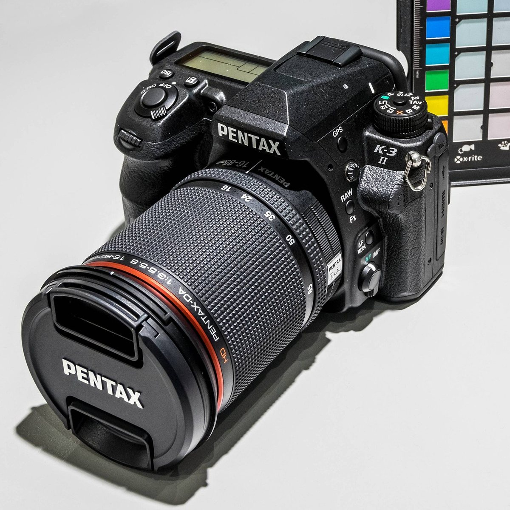

# PENTAX K-3 II 펌웨어 1.12 분석

리코가 배포한 K-3 II 펌웨어 `fwdc230b.bin`의 난독화를 풀고, 사진이 만들어져 저장되는 경로와 메뉴·AF·업데이트 코드를 추적한 연구 기록입니다.

**문서는 여기서 읽습니다 → [https://yunhyok.github.io/pentax-k3ii-firmware-analysis/](https://yunhyok.github.io/pentax-k3ii-firmware-analysis/)**



<sub>사진: © Jörgens.Mi/Wikipedia, [CC BY-SA 3.0](https://creativecommons.org/licenses/by-sa/3.0/), [Wikimedia Commons](https://commons.wikimedia.org/wiki/File:Pentax_K3-II_jm37903.jpg) (크기 축소). 자세한 출처는 [assets/photos/CREDITS.md](assets/photos/CREDITS.md).</sub>

> **먼저 알아 둘 점.** 모든 분석은 PC에서 했습니다. 수정한 펌웨어를 카메라에 설치하거나 실행한 적이 없습니다. 이 저장소에는 카메라에 넣을 수 있는 펌웨어가 없고, 원본 펌웨어와 난독화를 푼 바이너리도 없습니다.

## 무엇을 알아냈나

세 기종(K-3 Mark III, K-3 II, Q7)을 같은 네 가지 질문으로 조사합니다. K-3 II에서 온 지점은 다음과 같습니다.

| 질문 | 알아낸 것 | 아직 모르는 것 |
|---|---|---|
| 펌웨어를 고쳐서 다시 만들 수 있는가 | 난독화를 풀었다 다시 걸면 배포본과 바이트까지 같음. 톤 보간 함수를 C로 다시 짜서 원본 호출 코드와 대조 | 카메라가 수정본을 받아들이는지, 부팅하는지 |
| 카메라의 색은 어떻게 만들어지는가 | RAW에서 JPEG·SD 저장까지의 처리 단계, 톤·화이트밸런스·색 행렬 설정 | 실제 픽셀 처리 결과 |
| AF 동작을 바꿀 수 있는가 | 렌즈 능력에 따른 구동 방식 분기, AF 요청 계산과 구동 준비 | 실제 모터 이동과 초점 정확도 |
| K-3 Mark III의 화면을 옮길 수 있는가 | 색공간·RAW 형식 메뉴의 선택·확정·취소와 설정 저장 | 실제 버튼 입력에서 LCD까지 |

세 기종을 나란히 비교한 현황은 [세 기종 연구 본부](https://yunhyok.github.io/pentax-k3iii-firmware-analysis/analysis/research-program.html)에 있습니다.

## 문서 안내

주제마다 안내 문서가 있습니다. 안내 문서에서 전체 그림을 본 뒤 세부 문서로 들어가면 읽기 쉽습니다.

| 주제 | 안내 문서 |
|---|---|
| 시작하기 | [개요](https://yunhyok.github.io/pentax-k3ii-firmware-analysis/) · [펌웨어 파일 구조와 복호화](https://yunhyok.github.io/pentax-k3ii-firmware-analysis/analysis/firmware-structure.html) · [용어집](https://yunhyok.github.io/pentax-k3ii-firmware-analysis/glossary.html) |
| 영상 처리와 저장 경로 | [영상 처리 경로 안내](https://yunhyok.github.io/pentax-k3ii-firmware-analysis/analysis/guide-pipeline.html) |
| 촬영 준비와 보존 레코드 | [촬영 준비·보존 레코드 안내](https://yunhyok.github.io/pentax-k3ii-firmware-analysis/analysis/guide-capture.html) |
| 재구축과 업데이트 | [재구축·업데이트 안내](https://yunhyok.github.io/pentax-k3ii-firmware-analysis/analysis/guide-rebuild.html) |
| AF와 렌즈 제어 | [AF 안내](https://yunhyok.github.io/pentax-k3ii-firmware-analysis/analysis/guide-af.html) |
| 메뉴와 UI | [메뉴·UI 안내](https://yunhyok.github.io/pentax-k3ii-firmware-analysis/analysis/guide-ui.html) |

문서는 결과마다 얼마나 확실한지를 네 가지로 표시합니다: **확인**(원본 코드를 PC 에뮬레이터에서 실행해 관측), **정적 분석**(코드를 읽어서 판단), **모델**(실물 대신 넣은 값), **미확인**. 자세한 뜻은 [개요의 “검증 수준 읽는 법”](https://yunhyok.github.io/pentax-k3ii-firmware-analysis/#levels)에 있습니다.

GitHub에서 HTML 파일을 열면 소스가 보입니다. 오프라인으로 읽으려면 저장소를 내려받아 `index.html`을 브라우저로 여세요.

## 직접 확인하기

펌웨어 없이, 공개된 문서·근거 파일·도구가 서로 맞는지 검사합니다. Python 3.12만 있으면 됩니다.

```bash
python -m unittest discover -s tests -v
python verify_publication.py
```

리코 공식 사이트에서 받은 `fwdc230b.bin`이 있으면 난독화 해제부터 다시 해 볼 수 있습니다. 원본 코드 실행에는 `unicorn==2.1.4`가 필요합니다.

```bash
python inspect_firmware.py fwdc230b.bin --output-dir .private/decoded
python verify_findings.py .private/decoded/decoded.bin
```

주제별 검증기(`verify_*.py`)는 같은 이름의 근거 파일(`analysis/*.json`)과 짝을 이룹니다. 예를 들면 이렇습니다.

```bash
python verify_af_drive.py .private/decoded/decoded.bin --emulate --compare analysis/af-drive.json
```

각 문서의 “재현 방법” 절에 그 문서의 명령이 있습니다. 전체 명령은 아래에 접어 두었습니다.

<details>
<summary>검증 명령 전체 목록</summary>

```bash
python inspect_firmware.py fwdc230b.bin --output-dir .private/decoded
python verify_findings.py .private/decoded/decoded.bin
python verify_hardware.py .private/decoded/decoded.bin --compare analysis/hardware.json
python verify_raw_path.py .private/decoded/decoded.bin --compare analysis/raw-path.json
python verify_tone_path.py .private/decoded/decoded.bin --compare analysis/tone-path.json
python verify_pipeline_flow.py .private/decoded/decoded.bin --compare analysis/pipeline-flow.json
python verify_selector_path.py .private/decoded/decoded.bin --emulate --compare analysis/selector-path.json
python verify_isp_paths.py .private/decoded/decoded.bin --compare analysis/isp-paths.json
python verify_isp_numeric.py .private/decoded/decoded.bin --compare analysis/isp-numeric.json
python verify_jpeg_buffers.py .private/decoded/decoded.bin --compare analysis/jpeg-buffers.json
python verify_menu_events.py .private/decoded/decoded.bin --emulate --compare analysis/menu-events.json
python verify_exif_output.py .private/decoded/decoded.bin --compare analysis/exif-output.json
python verify_filesystem_backend.py .private/decoded/decoded.bin --compare analysis/filesystem-backend.json
python verify_sd_controller.py .private/decoded/decoded.bin --emulate --compare analysis/sd-controller.json
python verify_alternate_buffers.py .private/decoded/decoded.bin --compare analysis/alternate-buffers.json
python verify_backend_b.py .private/decoded/decoded.bin --compare analysis/backend-b.json
python verify_cpp_handoff.py .private/decoded/decoded.bin --compare analysis/cpp-handoff.json
python verify_masked_scaler.py .private/decoded/decoded.bin --compare analysis/masked-scaler.json
python verify_mode_reachability.py .private/decoded/decoded.bin --compare analysis/mode-reachability.json
python verify_superresolution_menu.py .private/decoded/decoded.bin --emulate --compare analysis/superresolution-menu.json
python verify_buffer_history.py .private/decoded/decoded.bin --compare analysis/buffer-history.json
python verify_scaler_gate.py .private/decoded/decoded.bin --compare analysis/scaler-gate.json
python verify_repack.py fwdc230b.bin --compare analysis/repack.json
python verify_af_drive.py .private/decoded/decoded.bin --emulate --compare analysis/af-drive.json
python verify_af_control.py .private/decoded/decoded.bin --emulate --compare analysis/af-control.json
python verify_af_input.py .private/decoded/decoded.bin --compare analysis/af-input.json
python verify_installation.py .private/decoded/decoded.bin --emulate --compare analysis/installation.json
python verify_ui_resources.py .private/decoded/decoded.bin --compare analysis/ui-resources.json
python verify_color_ui.py .private/decoded/decoded.bin --compare analysis/color-ui.json
python verify_ui_dispatch.py .private/decoded/decoded.bin --compare analysis/ui-dispatch.json
python verify_settings_storage.py .private/decoded/decoded.bin --compare analysis/settings-storage.json
python verify_preserved_record.py .private/decoded/decoded.bin --compare analysis/preserved-record.json
python verify_pixel_records.py .private/decoded/decoded.bin --compare analysis/pixel-records.json
python verify_pixel_policy.py .private/decoded/decoded.bin --compare analysis/pixel-policy.json
python verify_capture_prepare.py .private/decoded/decoded.bin --compare analysis/capture-prepare.json
python verify_store_image_records.py .private/decoded/decoded.bin --compare analysis/store-image-records.json
python verify_preserved_sector20.py .private/decoded/decoded.bin --compare analysis/preserved-sector20.json
python verify_preserved_config.py .private/decoded/decoded.bin --compare analysis/preserved-config.json
python verify_preserved_dispatch.py .private/decoded/decoded.bin --compare analysis/preserved-dispatch.json
python verify_tone_rebuild.py .private/decoded/decoded.bin --zig <Zig-0.17.1-실행파일> --compare analysis/tone-rebuild.json
python -m unittest discover -s tests -v
python verify_publication.py
```

</details>

톤 함수 C 재컴파일에는 pyelftools와 Zig 0.17.1도 필요하며, 설치와 빌드 옵션은 [톤 보간 함수 C 재구현](https://yunhyok.github.io/pentax-k3ii-firmware-analysis/analysis/tone-rebuild.html#reproduce)에 적었습니다.

## 저장소 구성

| 경로 | 내용 |
|---|---|
| `index.html`, `glossary.html`, `analysis/*.html` | 분석 문서 |
| `analysis/*.json` | 측정 결과(근거 파일). `analysis/hq-status.json`은 연구 목표별 상태 기록 |
| `inspect_firmware.py`, `repack_firmware.py`, `verify_*.py` | 분석·검증 도구 |
| `rebuild/` | 직접 작성한 재구성 C 코드 |
| `tests/` | 단위 테스트 |
| `assets/`, `site-map.json`, `tools/site_chrome.py` | 문서 스타일, 문서 목록, 내비게이션 갱신 도구 |
| `docs/audit/` | 문서 검수 기록 (무엇을 확인했고 무엇을 고쳤는지, 판단이 필요한 항목) |
| `docs/releases/` | 릴리스 노트 |

문서를 추가하거나 순서를 바꿀 때는 `site-map.json`을 고친 뒤 `python tools/site_chrome.py`를 실행하면 모든 문서의 상단 메뉴와 이전·다음 링크가 갱신됩니다.

## 릴리스

[릴리스 목록](https://github.com/yunhyok/pentax-k3ii-firmware-analysis/releases)에서 문서와 도구를 묶은 ZIP과 SHA-256을 받을 수 있습니다. `docs/releases/<태그>.md`를 main에 병합하면 릴리스 워크플로가 검사를 돌린 뒤 릴리스를 만듭니다.

## 공개 범위와 라이선스

분석 도구는 [GPL-2.0](LICENSE)으로 배포합니다. 제조사 펌웨어에는 이 저장소의 라이선스가 적용되지 않습니다. 난독화 방식의 출처와 공개 범위는 [펌웨어 파일 구조와 복호화](https://yunhyok.github.io/pentax-k3ii-firmware-analysis/analysis/firmware-structure.html#sources)에 정리했습니다. 사진의 라이선스는 [assets/photos/CREDITS.md](assets/photos/CREDITS.md)에 따로 적었습니다.

## 관련 저장소

- [K-3 Mark III 펌웨어 분석](https://github.com/yunhyok/pentax-k3iii-firmware-analysis) — 세 기종 연구 본부와 Lightroom 색 프로파일 연구 포함
- [Q7 펌웨어 분석](https://github.com/yunhyok/pentax-q7-firmware-analysis)
